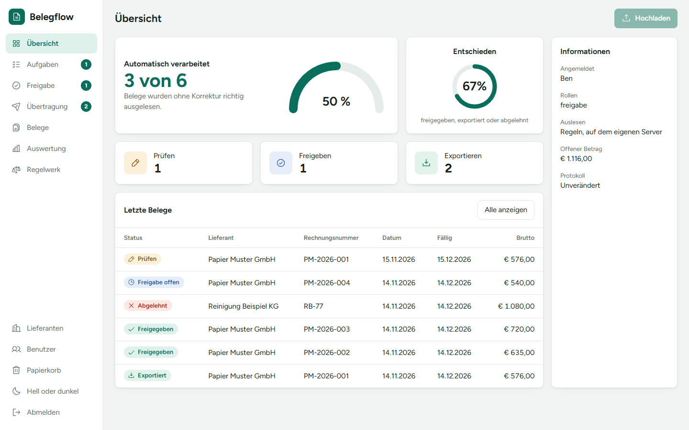
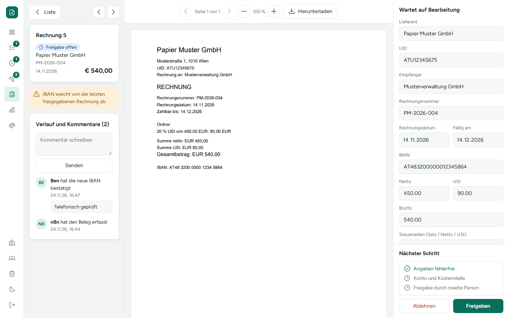
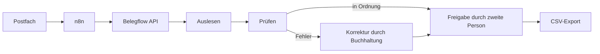

# Belegflow

Automatische Erfassung von Eingangsrechnungen: Belege kommen per E-Mail über n8n, werden ausgelesen, geprüft, von Menschen freigegeben und für die Buchhaltung exportiert.





## Ablauf



## Was es kann

- **Auslesen:** regelbasiert auf dem eigenen Server oder mit Claude für beliebige Layouts, Scans und Fotos
- **Prüfen:** Pflichtangaben, Summen, Steuersätze, UID-Prüfziffer, IBAN-Prüfziffer, Termine, doppelte Rechnungen
- **Betrugsschutz:** eine geänderte IBAN blockiert die Freigabe, bis jemand sie mit Begründung bestätigt
- **Vier-Augen-Prinzip:** wer einen Beleg korrigiert, kann ihn nicht selbst freigeben
- **Nachvollziehbarkeit:** jede Aktion steht in einem verketteten Protokoll, Änderungen an Einträgen fallen auf
- **Kontierung:** Konto und Kostenstelle kommen aus Regeln oder vom letzten Beleg des Lieferanten
- **Zusammenarbeit:** Kommentare und Verlauf direkt am Beleg
- **Auswertung:** Anteil der automatisch richtig gelesenen Belege, offene Fehler, Belege pro Monat

Die KI entscheidet nichts. Sie liest nur Werte aus, die danach durch feste Regeln und eine Person geprüft werden.

## Starten

```bash
cp .env.example .env
docker compose up --build
```

Die Oberfläche läuft auf http://localhost:8000, die API-Dokumentation auf http://localhost:8000/docs. Vor dem Start in `.env` eigene Tokens und ein Datenbank-Passwort setzen.

Ohne Docker:

```bash
python -m venv .venv
.venv/bin/pip install -r requirements.txt
.venv/bin/uvicorn app.main:app
```

Unter Windows heißt der Ordner `.venv\Scripts` statt `.venv/bin`.

Demo-Rechnungen mit erfundenen Firmen erzeugen:

```bash
pip install -r requirements-dev.txt
python -m demo.erzeuge_belege
```

## Auslesen mit Claude

In `.env` `BELEGFLOW_EXTRAKTOR=claude` und `ANTHROPIC_API_KEY` setzen. Der Aufruf ist kostenpflichtig, das Modell ist über `BELEGFLOW_CLAUDE_MODELL` wählbar. Die Belege werden dabei an die API von Anthropic übertragen. Das braucht vor dem Einsatz mit echten Daten eine Prüfung nach DSGVO und einen Auftragsverarbeitungsvertrag.

## n8n

`workflows/belegflow.json` importieren, beim Knoten „Postfach“ die IMAP-Zugangsdaten hinterlegen und für n8n diese Variablen setzen:

| Variable | Bedeutung |
|---|---|
| `BELEGFLOW_URL` | Adresse der API |
| `BELEGFLOW_TOKEN` | Token eines Benutzers mit Rolle `eingang` |
| `N8N_BLOCK_ENV_ACCESS_IN_NODE` | `false`, damit der Workflow die Variablen lesen darf |

Der Knoten „Upload“ ist ein Webhook zum Ausprobieren ohne Postfach. Vor einem öffentlichen Betrieb muss er entfernt oder abgesichert werden.

## Rollen

| Rolle | Darf |
|---|---|
| `eingang` | Belege einreichen |
| `buchhaltung` | Belege einreichen, korrigieren, kontieren, exportieren |
| `freigabe` | freigeben, ablehnen, neue IBAN bestätigen |

## Tests

```bash
pip install -r requirements-dev.txt
pytest
ruff check .
```

Die CI führt die Tests mit SQLite und mit PostgreSQL aus.

## Grenzen

- Der CSV-Export ist ein neutrales Format. Eine Anbindung an BMD NTCS ist nicht enthalten.
- Die regelbasierte Auslesung versteht Textrechnungen mit üblichen deutschen Bezeichnungen, andere Layouts brauchen Claude.
- Die Prüfungen ersetzen keine steuerliche Beratung.
- Es gibt keine Benutzerverwaltung mit Single Sign-on, Zugänge laufen über Tokens.

## Verwendete Bausteine

Schrift Figtree (SIL Open Font License) und Icons von Phosphor (MIT) liegen im Projekt, die Oberfläche lädt nichts von fremden Servern.
