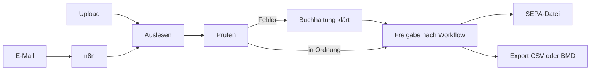
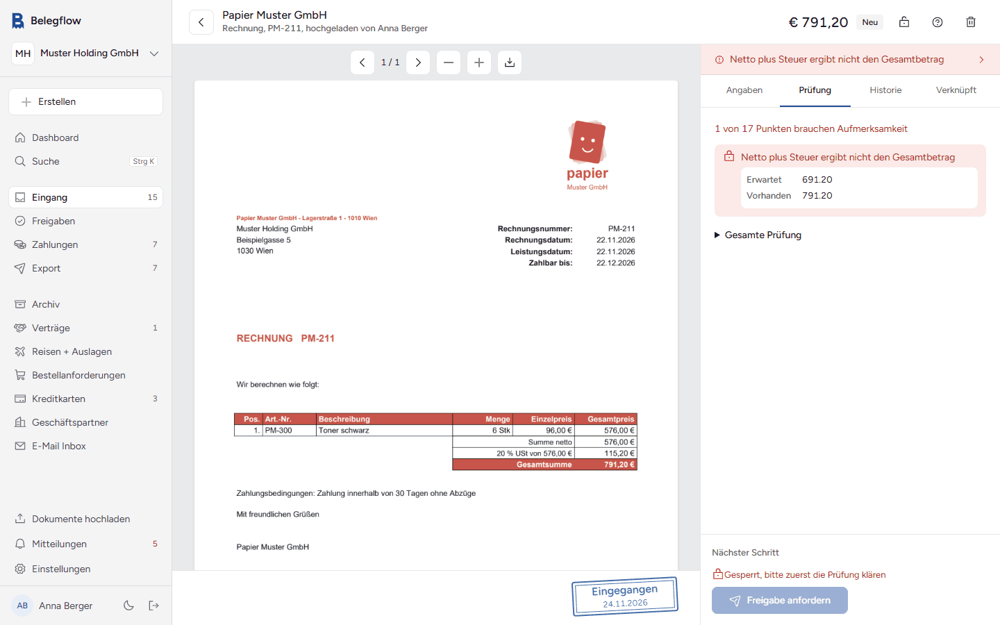
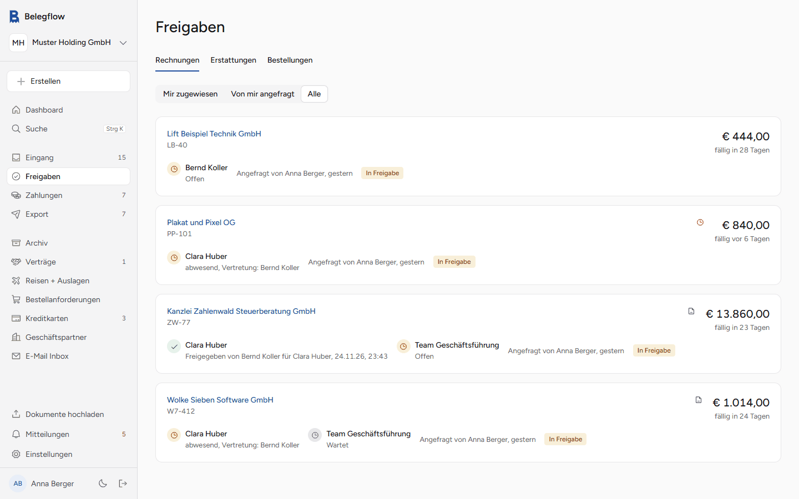
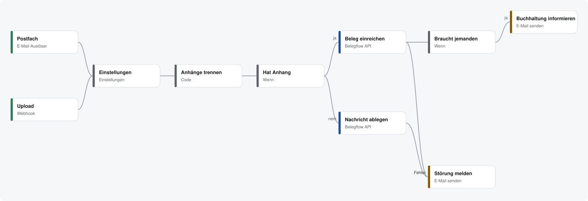
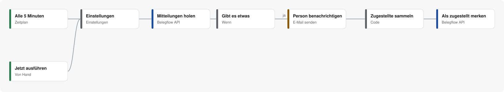
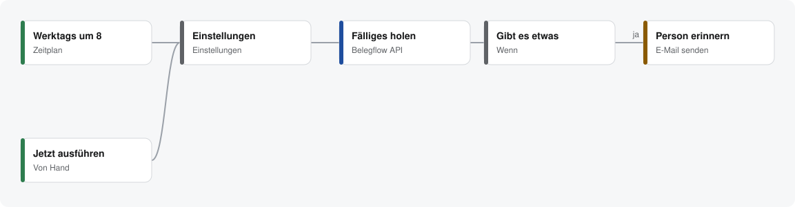

<p><picture><source media="(prefers-color-scheme: dark)" srcset="docs/logo/logo-quer-dunkel.svg"></picture></p>

Belegflow bringt Eingangsrechnungen vom Postfach bis zur Zahlung: auslesen, prüfen, freigeben, bezahlen, exportieren. Für österreichische Buchhaltungen mit einer oder mehreren Firmen.

**Demo:** https://belegflow-demo.vercel.app (Zugang auf Anfrage, alle Firmen und Beträge sind erfunden)


## Ablauf



## Was es kann

- **Auslesen:** PDF nach Regeln auf dem eigenen Server, E-Rechnungen (XRechnung, ZUGFeRD, ebInterface) direkt aus den Daten, Scans und Fotos wahlweise mit einem Sprachmodell
- **Prüfen:** bis zu 18 Punkte je Rechnung, darunter Pflichtangaben, Summen, Steuersätze, UID, IBAN, Fristen und Duplikate
- **Betrugsschutz:** eine geänderte IBAN sperrt die Rechnung, bis jemand sie mit Begründung bestätigt
- **Freigeben:** Workflows nach Betrag und Kostenstelle, Teams, Vertretung bei Abwesenheit, Vier-Augen-Prinzip
- **Bezahlen:** SEPA-Datei für das Onlinebanking, Skonto, keine Doppelzahlung
- **Exportieren:** CSV, BMD-Format, ZIP mit Belegen, Rückstellungen zum Monatsende
- **Dazu:** Verträge mit Fristen, Erstattungen mit Taggeld und Kilometergeld, Bestellanforderungen mit Wareneingang, Firmenkarten, Budgets
- **Mandanten:** mehrere Firmen getrennt, Rechte je Firma
- **Nachvollziehbar:** jede Aktion steht in einem verketteten Protokoll, nachträgliche Änderungen fallen auf

Ein Sprachmodell liest nur Werte aus. Entscheidungen treffen feste Regeln und Menschen.

| Prüfung | Freigabe |
|---|---|
|  |  |

## Starten

```bash
cp .env.example .env
docker compose up --build
docker compose exec api python -m app.verwaltung demo
```

In `.env` vorher ein eigenes Datenbank-Passwort setzen. Der letzte Befehl legt erfundene Firmen und Belege an und zeigt die Zugänge. Die Oberfläche läuft auf http://localhost:8000, die Beschreibung der API auf http://localhost:8000/docs.

Ohne Docker:

```bash
python -m venv .venv
.venv/bin/pip install -r requirements.txt
.venv/bin/python -m app.verwaltung demo
BELEGFLOW_SICHERE_COOKIES=false .venv/bin/uvicorn app.main:app
```

Unter Windows heißt der Ordner `.venv\Scripts`, und die Variable wird vorher mit `$env:BELEGFLOW_SICHERE_COOKIES = "false"` gesetzt.

Für den echten Betrieb legt `python -m app.verwaltung admin` die erste Person und die erste Firma an.

## n8n

| Workflow | Auslöser | Was er tut |
|---|---|---|
| [Rechnungseingang](workflows/1_rechnungseingang.json) | neue E-Mail oder Upload | trennt Anhänge, reicht jeden Beleg ein, meldet Fehler, Duplikate und Störungen |
| [Mitteilungen](workflows/2_mitteilungen.json) | alle 5 Minuten | schickt Mitteilungen per E-Mail und merkt nur die zugestellten als erledigt |
| [Erinnerungen](workflows/3_erinnerungen.json) | werktags um 8 Uhr | schickt jeder Person ihre offenen Freigaben, Vertragsfristen und fehlenden Belege |







Nach dem Import im Knoten „Einstellungen“ Adresse, Mandant, Absender und Postfach der Buchhaltung eintragen. Dazu diese Zugangsdaten in n8n anlegen:

| Zugang | Art | Inhalt |
|---|---|---|
| Belegflow Eingang | Header Auth | `Authorization: Bearer …`, Zugang mit Rolle `eingang` |
| Belegflow Schnittstelle | Header Auth | `Authorization: Bearer …`, Zugang mit Rolle `schnittstelle` |
| Belegflow Upload | Header Auth | eigener Schlüssel für den Webhook |
| Belegflow SMTP | SMTP | Postausgang |
| Rechnungspostfach | IMAP | Posteingang der Rechnungen |

Die Zugänge für Belegflow entstehen unter Einstellungen, Zugänge. Dieselbe Datei wird nur einmal erfasst, ein Workflow darf deshalb beliebig oft wiederholt werden.

## Rollen

| Rolle | Darf |
|---|---|
| `buchhaltung` | erfassen, prüfen, kontieren, Freigaben anfordern, zahlen, exportieren |
| `freigabe` | freigeben, ablehnen, neue IBAN bestätigen |
| `mitarbeit` | Erstattungen und Bestellanforderungen einreichen |
| `einsicht` | alles sehen, nichts ändern |
| `admin` | Personen, Workflows und Stammdaten verwalten |

## Auslesen mit Sprachmodell

In `.env` `BELEGFLOW_EXTRAKTOR=modell`, `BELEGFLOW_MODELL` und `ANTHROPIC_API_KEY` setzen. Aufrufe kosten Geld und übertragen die Belege an den Anbieter. Vor dem Einsatz mit echten Daten braucht das eine Prüfung nach DSGVO und einen Vertrag zur Auftragsverarbeitung.

## Technik

Python, FastAPI, SQLAlchemy, PostgreSQL oder SQLite, JavaScript ohne Framework, n8n, Docker.

```bash
pip install -r requirements-dev.txt
pytest
ruff check .
```

Die CI führt die Tests mit SQLite und mit PostgreSQL aus.

## Grenzen

- Der BMD-Export folgt dem veröffentlichten Importformat, wurde aber nicht in einem echten BMD NTCS getestet.
- Die Regeln lesen Textrechnungen mit üblichen deutschen Bezeichnungen. Andere Layouts und Scans brauchen das Sprachmodell.
- Firmenkarten und Kontobewegungen sind nachgebildet, es gibt keine Bankanbindung.
- Anmeldung mit E-Mail und Passwort, kein Single Sign-on.
- Datenbank-Migrationen fehlen noch, neue Tabellen entstehen beim Start.
- Die Prüfungen ersetzen keine steuerliche Beratung.

## Verwendete Bausteine

Schrift Figtree (SIL Open Font License) und Icons von Phosphor (MIT) liegen im Projekt. Die Oberfläche lädt nichts von fremden Servern.
